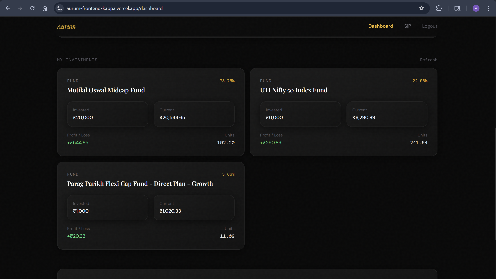
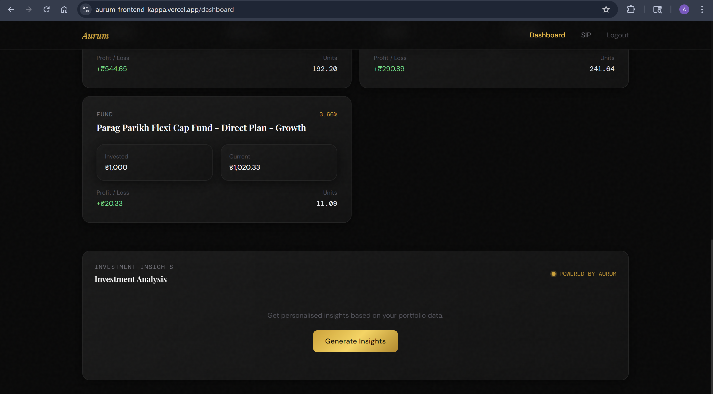
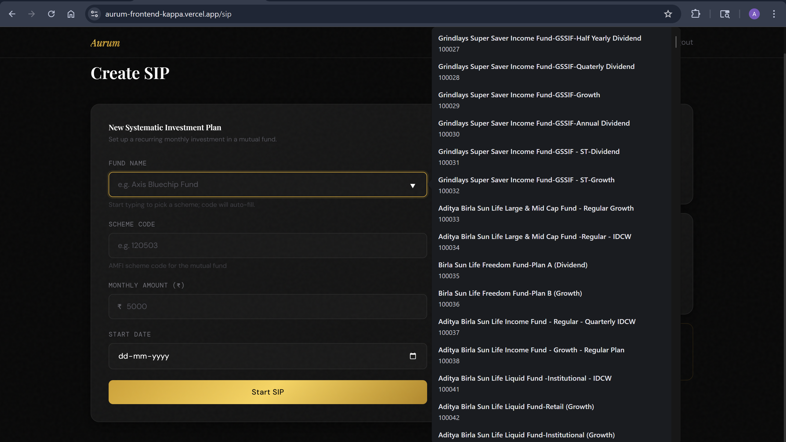
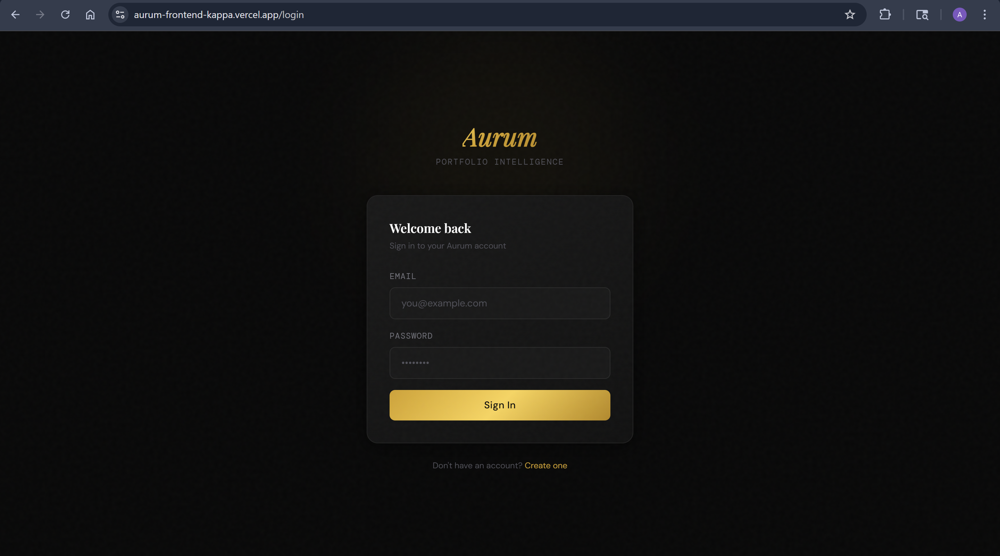
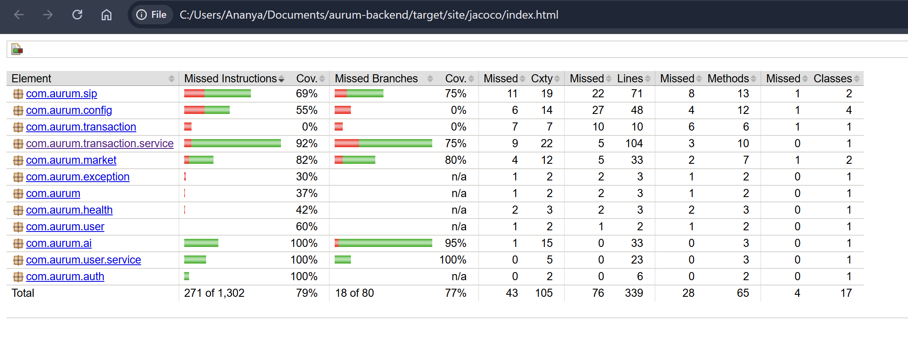

# Aurum — SIP Portfolio Tracker

Aurum is a full-stack investment tracking application that helps users manage their Systematic Investment Plans (SIPs), monitor portfolio performance, and understand their investment progress through portfolio summaries and rule-based insights.

It integrates mutual fund NAV data to calculate SIP holdings, current portfolio values, and profit/loss.

**[Live Application](https://aurum-frontend-kappa.vercel.app/)**

## Screenshots

### Portfolio Dashboard

View total invested amount, current portfolio value, profit/loss, investment duration, and portfolio allocation.


### SIP Holdings

Track individual mutual funds, invested amounts, current values, units, and profit/loss.



### Investment Insights

Generate rule-based insights based on investment duration, returns, and invested amount.



### Create a SIP

Choose a mutual fund scheme, enter the monthly investment amount, and set the SIP start date.



### Authentication

Secure account access through JWT-based authentication.



### Backend Test Coverage

The backend test suite is measured using JaCoCo.



## Features

- **JWT Authentication:** User signup and login.
- **SIP Management:** Create and view systematic investment plans.
- **Portfolio Summary:** Track total invested amount, current value, profit/loss, and investment duration.
- **NAV-Based Valuation:** Calculate SIP units and current values using historical mutual fund NAV data.
- **Mutual Fund Schemes:** Fetch mutual fund scheme names and codes for selection in the frontend.
- **Investment Insights:** Generate rule-based insights using portfolio data.
- **Automated Testing:** Test authentication, SIP calculations, portfolio transactions, market-data handling, and investment insights.
- **Continuous Integration:** Automatically build and test the backend through GitHub Actions.

## Tech Stack

| Category | Technologies |
|---|---|
| Language | Java 17 |
| Backend | Spring Boot |
| Security | Spring Security, JWT |
| Database | PostgreSQL, Spring Data JPA, Hibernate |
| Frontend | React |
| Backend Deployment | Render |
| Frontend Deployment | Vercel |
| Database Hosting | Neon PostgreSQL |
| External Market Data | [MFAPI](https://api.mfapi.in/) |
| Testing | JUnit 5, Mockito |
| Code Coverage | JaCoCo |
| CI | GitHub Actions |

## How It Works

1. Users sign up or log in to access their portfolios.
2. SIP investments are stored and associated with the user's portfolio.
3. The backend retrieves mutual fund NAV data from MFAPI.
4. The application calculates invested amounts, units, current values, and profit/loss.
5. Portfolio summaries and rule-based insights help users understand their investment progress.

## API Endpoints

### Authentication

| Method | Endpoint | Description |
|---|---|---|
| POST | `/api/v1/auth/signup` | Register a new user |
| POST | `/api/v1/auth/login` | Authenticate a user and obtain a JWT |

### SIP Management

| Method | Endpoint | Description |
|---|---|---|
| POST | `/api/v1/sip` | Create a SIP |
| GET | `/api/v1/sip` | Retrieve SIP investments |
| GET | `/api/v1/sip/summary` | Retrieve SIP summary |
| GET | `/api/v1/sip/ai-insights` | Retrieve rule-based investment insights |

### Mutual Fund Data

| Method | Endpoint | Description |
|---|---|---|
| GET | `/api/v1/amfi/schemes` | Fetch mutual fund schemes and scheme codes |

## Testing and Code Coverage

The backend uses JUnit 5 and Mockito for automated testing.

- **26 targeted tests** covering application logic and error-handling scenarios.
- **79% instruction coverage** and **77% branch coverage**, measured using JaCoCo.
- **27 total Maven tests**, including the Spring Boot context-load test.
- **GitHub Actions CI** builds the project and runs the test suite against PostgreSQL on every push and pull request.

### Run Tests Locally

Windows PowerShell:

```powershell
.\mvnw.cmd clean verify
